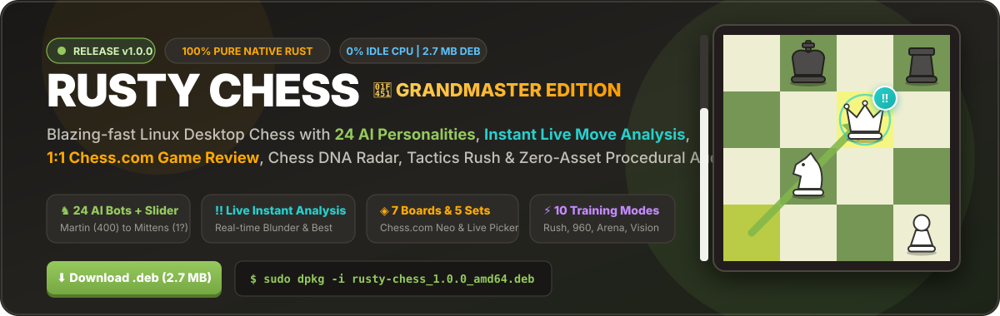
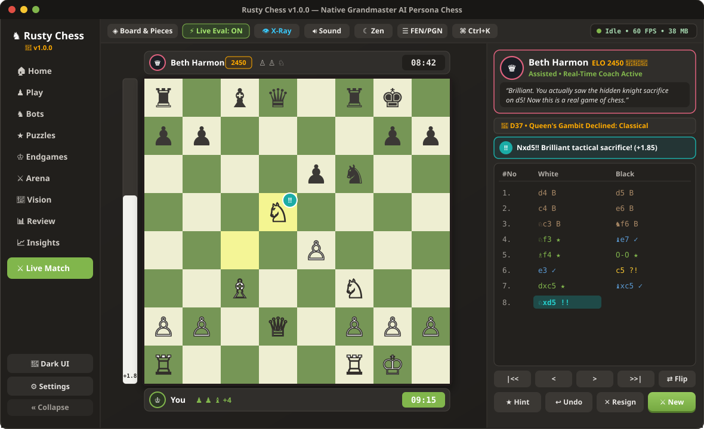
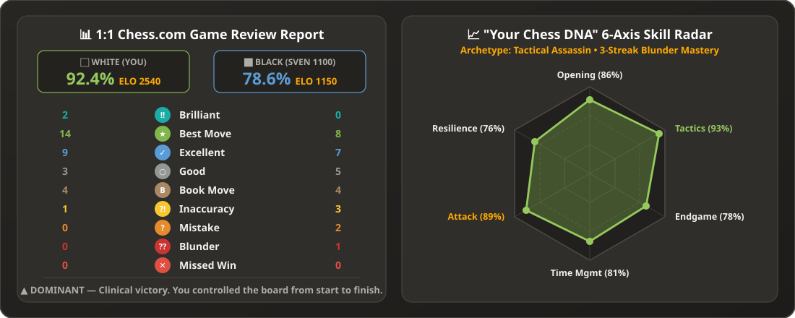

<div align="center">



<br/>

[](https://github.com/YoriSyahputra/rusty-chess/releases/tag/v1.0.0)
[](https://github.com/YoriSyahputra/rusty-chess/releases/download/v1.0.0/rusty-chess_1.0.0_amd64.deb)
[](Cargo.toml)
[](#performance--architecture)
[](#performance--architecture)
[](tests/)
[](#license)

<p align="center">
  <b>A blazingly fast, zero-Electron, 100% self-contained Linux Desktop Chess Suite written in pure Rust.</b><br/>
  Challenge <b>24 calibrated AI personalities</b> (from Beginner <i>Martin 400</i> to <i>Beth Harmon 2450</i>, <i>Hikaru 2800</i>, <i>Magnus 2882</i> &amp; <i>Mittens 1?</i>), get <b>Instant Live Move Classifications (<code>!!</code> / <code>★</code> / <code>??</code>)</b> as you play, inspect your <b>1:1 Chess.com Accuracy Report &amp; 6-Axis Chess DNA</b>, and train across <b>10 specialized modes</b>.
</p>

[⬇ **Download `.deb` Installer (2.7 MB)**](https://github.com/YoriSyahputra/rusty-chess/releases/download/v1.0.0/rusty-chess_1.0.0_amd64.deb) · [✨ **25+ Flagship Features**](#-25-flagship-features) · [♞ **24 AI Bot Personalities**](#-24-ai-bot-personalities--crown-progression) · [📊 **Live Analysis & Game Review**](#-instant-live-analysis--11-chesscom-game-review) · [🏗 **Architecture**](#-performance--architecture)

</div>

---

## 🖥 Desktop Interface & Live Match Preview

<div align="center">
  
</div>

---

## 📦 Quick Install (Ubuntu / Debian / Linux Mint / Pop!_OS)

### Option 1 — Install the Prebuilt `.deb` Package (Recommended, ~2.7 MB)

Download [`rusty-chess_1.0.0_amd64.deb`](https://github.com/YoriSyahputra/rusty-chess/releases/download/v1.0.0/rusty-chess_1.0.0_amd64.deb) from [**GitHub Releases**](https://github.com/YoriSyahputra/rusty-chess/releases/tag/v1.0.0) (or directly from [`releases/rusty-chess_1.0.0_amd64.deb`](releases/rusty-chess_1.0.0_amd64.deb) in this repository) and install with `dpkg`:

```bash
sudo dpkg -i releases/rusty-chess_1.0.0_amd64.deb
```

Once installed:
- Launch from your **Ubuntu Applications Menu / GNOME Dock** by searching **"Rusty Chess"**, or
- Run `rusty-chess` from any terminal.

### Option 2 — Build from Source (Optimized for Low-RAM Laptops)

```bash
git clone https://github.com/YoriSyahputra/rusty-chess.git
cd rusty-chess

# Build and launch the native release binary
cargo run --release

# Or build your own .deb installer in ~2 seconds (--fast skips redundant debug test recompile)
./scripts/build-deb.sh --fast
sudo dpkg -i rusty-chess_1.0.0_amd64.deb
```

---

## 📊 Instant Live Analysis & 1:1 Chess.com Game Review

<div align="center">
  
</div>

- **⚡ Instant Real-Time Move Classification (`Live Eval: ON/OFF`)**: Toggleable anytime right from the Top Bar. Every move is evaluated in **&lt;30 ms** as you play—immediately popping a spring-animated badge (**`!!` Brilliant**, **`!` Great**, **`★` Best Move**, **`✓` Excellent**, **`○` Good**, **`B` Book Move**, **`?!` Inaccuracy**, **`?` Mistake**, **`??` Blunder**, **`✕` Missed Win**) onto the board square alongside a live coach card and one-click **`Best`** recommendation arrow.
- **📊 1:1 Chess.com Classification Breakdown Report**: Full post-game accuracy percentages (`0–100%`), estimated match performance ELO, interactive Win-Probability & Move-Time dual charts, all 9 classification tally rows for White & Black, and an automatic Game Mood verdict (`DOMINANT`, `CLEAN`, `SHARP`, `ROUGH`).
- **🎓 Natural-Language Coach ("Why Was That a Blunder?")**: Explains tactical motifs in plain English (hanging pieces, missed forks, back-rank mates, king safety) with an interactive **3-Ply Refutation Stepper** (`▶ Show Refutation`) and **"🎯 Retry This Mistake"** drill mode.
- **🔬 Top-3 Multi-PV Free Analysis Sandbox**: Explore any variation freely for both sides while viewing the live **Top 3 Engine Lines** with color-coded board arrows (`Green #1`, `Blue #2`, `Yellow #3`).

---

## ✨ 25+ Flagship Features

<table>
  <tr>
    <td width="50%" valign="top">
      <h3>🎨 Authentic Chess.com Visuals &amp; Juice</h3>
      <ul>
        <li><b>7 Board Themes with Live 4×4 Swatch Previews</b>: <i>Classic Green</i>, <i>Walnut Wood</i>, <i>Emerald</i>, <i>Tournament Blue</i>, <i>Icy Sea</i>, <i>Newspaper</i>, and <i>Dark Slate</i> with subtle procedural surface micro-textures.</li>
        <li><b>5 Procedural Vector Piece Sets</b>: Default sculpted <i>Chess.com Neo</i>, <i>Classic Staunton</i>, <i>Minimalist Alpha</i>, <i>Pixel 8-Bit</i>, and <i>Neon Wireframe</i> with live 6-piece preview strips.</li>
        <li><b>Soft Feathered Shadows &amp; Arc Glide Physics</b>: 3-layer elliptical contact shadows, smooth cubic ease-out sliding arcs, capture particle bursts, Brilliant cyan shockwaves, and victory confetti.</li>
        <li><b>Multi-Premove Queue (Up to 5 Moves)</b>: Chain up to 5 premoves during the bot's turn with numbered crimson badges and right-click cancellation.</li>
        <li><b>4-Color Tactical Annotation</b>: Right-drag arrows and square highlights with <code>Shift</code>/<code>Alt</code>/<code>Ctrl</code> modifiers (Green, Red, Yellow, Blue).</li>
      </ul>
    </td>
    <td width="50%" valign="top">
      <h3>🧠 Analytics, Audio &amp; Training Modes</h3>
      <ul>
        <li><b>📈 "Your Chess DNA" 6-Axis Radar Chart</b>: Tracks <i>Opening</i>, <i>Tactics</i>, <i>Endgame</i>, <i>Time Mgmt</i>, <i>Attack</i>, and <i>Resilience</i> + personal ECO Opening Repertoire W/D/L table.</li>
        <li><b>👁 X-Ray Square Control Heatmap (<code>X</code>)</b>: Visualizes net attacker/defender balance on all 64 squares and pulses hanging pieces + Knight-fork threat lasers.</li>
        <li><b>🔥 Spaced-Repetition Personal Blunder Deck</b>: Automatically harvests blunders from your matches into a personal drill vault (solve 3× in a row to master).</li>
        <li><b>⚡ Puzzle Rush &amp; 32 Curated Tactics</b>: 3-Minute Timed Rush, 3-Strike Survival, and 5-Heart Hard Mode.</li>
        <li><b>♔ Endgame Mastery, ⚔ Bot Arena, 🎲 Chess960, 🎯 30s Vision &amp; 🙈 Blindfold Mode</b>.</li>
        <li><b>🔊 Zero-Asset Procedural PCM Audio Synth</b>: 4 selectable sound themes (<i>Classic Wood</i>, <i>Tournament Crisp</i>, <i>Marble Clink</i>, <i>8-Bit Retro</i>) + <code>&lt;10s</code> low-time urgency ticks.</li>
      </ul>
    </td>
  </tr>
</table>

---

## ♞ 24 AI Bot Personalities & Crown Progression

Earn up to **72 Crowns (`3★` per bot)** across **4 Assistance Modes**:
- **Challenge (`⭐⭐⭐` 3 Crowns Max)** — Pure tournament conditions: no hints, no takebacks, eval bar hidden.
- **Friendly (`⭐⭐☆` 2 Crowns Max)** — Up to 3 hints and 3 takebacks with live move feedback.
- **Assisted (`⭐☆☆` 1 Crown Max)** — Unlimited hints/takebacks, live Eval Bar, threat lasers, and real-time coach arrows.
- **Custom (`1–3★`)** — Granular toggles for chat, eval bar, threat arrows, and takebacks.

| Tier | Bot Persona | ELO | Signature Style & Opening Repertoire |
| :--- | :--- | :---: | :--- |
| **Adaptive** | **Adaptive Jimmy** | `400–2200` | Dynamically scales search depth & precision to match your performance |
| **Beginner** | **Martin** | `400` | Friendly novice; pushes flank pawns and leaves occasional pieces unguarded |
| **Beginner** | **Elani** | `400` | Enthusiastic newcomer who loves wing pawn advances |
| **Beginner** | **Wayne** | `500` | Flank pawn enthusiast & chaotic early trader |
| **Beginner** | **Jimmy** | `600` | Casual club newcomer; develops Knights early |
| **Beginner** | **Aron** | `700` | Principled beginner; plays standard `1.e4` openings |
| **Beginner** | **Maria** | `850` | Italian Game student; castles early and avoids 1-move Queen hangs |
| **Intermediate** | **Emir** | `1000` | Solid `1.d4` & Italian tactician; defends hanging pieces reliably |
| **Intermediate** | **Sven** | `1100` | Nordic Brawler; seeks central pawn breaks and punishes free hangers |
| **Intermediate** | **Wendy** | `1200` | Sicilian Counter-Puncher (`1...c5`) with queenside counterplay |
| **Intermediate** | **Nelson** | `1300` | The Queen Attack Menace; brings Queen out on move 2 (`Qh5`/`Qf3`) |
| **Intermediate** | **Jade** | `1400` | Gambit Swashbuckler; King's Gambit (`1.e4 e5 2.f4`) & open tactics |
| **Advanced** | **Antonio** | `1500` | Classical Club Champion; Ruy Lopez & Queen's Gambit Declined |
| **Advanced** | **Isabel** | `1600` | Fortress Architect; rock-solid structures & kingside safety |
| **Advanced** | **David** | `1700` | Caro-Kann & Slav Wall; neutralizes attacks and grinds rook endgames |
| **Advanced** | **Wally** | `1800` | Calculation Grinder; punishes greedy pawn grabs |
| **Advanced** | **Li** | `2000` | Endgame Technician; patient positional maneuvering |
| **Master** | **Noam** | `2200` | Veteran National Master; deep calculation with minimal centipawn loss |
| **Master** | **Francis** | `2300` | Positional Outpost Master; knight outposts & quiet squeezing |
| **Master** | **Beth Harmon** | `2450` | Queen's Gambit Prodigy; razor-sharp `1.d4 c4` & Sicilian killer instinct |
| **Top Player** | **IM Danny** | `2500` | International Master & Commentator; active bishop pairs & sharp gambits |
| **Top Player** | **Hikaru Nakamura** | `2800` | GM Speed Demon; lightning-fast tempo, Sicilian Najdorf & KID fireworks |
| **Top Player** | **Magnus Carlsen** | `2882` | The GOAT; peak positional mastery (`1.60`) & clinical endgame squeeze (`1.85`) |
| **Personality** | **Mittens** | `1? (3200)` | Cosmic Feline Overlord; displays ELO `1` while searching at maximum depth 7 |
| **Engine** | **Custom Engine** | `250–3200` | Configurable synthetic sparring engine in `50 ELO` increments (+ External Stockfish UCI Bridge) |

---

## ⌨️ Keyboard Shortcuts & Command Palette

| Shortcut | Action |
| :---: | :--- |
| `Ctrl + K` | Open **Spotlight Command Palette** & direct keyboard **SAN Move Entry** (type `Nf3`, `e4`, `O-O`, etc.) |
| `X` | Toggle **X-Ray Square Control & Hanging Piece Heatmap** |
| `Z` | Toggle distraction-free **Zen / Focus Mode** during a live match |
| `F` | **Flip Board** orientation (White / Black perspective) |
| `←` / `→` | Step **Previous / Next Move** in match history |
| `Home` / `End` | Jump to **First Move** or **Latest Live Position** |
| `Right-Click Drag` | Draw **Tactical Arrows** (`Green` default, `Shift` Red, `Alt` Blue, `Ctrl` Yellow) |

---

## 🏗 Performance & Architecture

```mermaid
flowchart LR
    subgraph UI["eframe / egui 0.29 Reactive UI Thread (0% Idle CPU)"]
        Sidebar["Left Nav Sidebar"]
        Board["8x8 Vector Board + Anim Layer"]
        Panel["Bounded Right Panel & Live Coach"]
        Pages["10 Routes: Home, Bots, Puzzles, Review, DNA, Arena, 960, Vision"]
    end

    subgraph Domain["Pure Domain Layer (shakmaty 0.27)"]
        State["ChessMatchState + Chess960"]
        ECO["130+ Embedded ECO Opening Book"]
        Audio["Procedural 22kHz PCM WAV Synth"]
    end

    subgraph Engine["Background Engine Worker + Review"]
        Search["Iterative Deepening Negamax + PVS + Quiescence"]
        TT["Fixed 8 MB Zobrist Transposition Table"]
        Eval["Tapered PeSTO Eval + 24 Bot Personas"]
        UCI["Optional External Stockfish UCI Bridge"]
    end

    UI <-->|"mpsc Channels + AtomicBool Abort"| Engine
    UI --> Domain
    Engine --> Domain
```



| Metric | Target Constraint | Measured `v1.0.0` Result |
| :--- | :---: | :---: |
| **Idle CPU Usage** | `0.0%` (Reactive Repaint) | **`0.0%`** (Zero repaints when board, clocks & animations are idle) |
| **Memory Footprint (RSS)** | `< 80 MB` | **`~36–44 MB`** (including fixed `8 MB` Transposition Table & texture cache) |
| **Release Binary Size** | `< 15 MB` | **`8.1 MB`** stripped native ELF binary (`2.7 MB` compressed `.deb`) |
| **External Runtime Assets** | `0 files` | **`0 files`** (100% procedural vector graphics & synthesized PCM audio) |

---

## 🗂 Repository Structure

```text
rusty-chess/
├── assets/                   # Vector hero banner, UI preview, and Game Review showcase SVGs
├── packaging/debian/         # Debian .deb control metadata, postinst, .desktop launcher & SVG icon
├── releases/                 # Prebuilt rusty-chess_1.0.0_amd64.deb installer package
├── scripts/build-deb.sh      # Automated Debian package builder (--fast flag supported)
├── src/
│   ├── audio/                # Pure-Rust procedural 16-bit PCM WAV synthesizer & Linux pipe player
│   ├── domain/               # Board state, clocks, SAN/FEN/PGN, 130+ ECO detector & Scharnagl Chess960
│   ├── engine/               # Negamax alpha-beta, TT, PeSTO eval, 24 bots, Live Review, Coach & UCI bridge
│   ├── ui/                   # Chess.com theme, 5 vector piece sets, 7 board textures, animations & 10 pages
│   ├── app.rs                # Top-level reactive application state & route orchestrator
│   ├── config.rs             # Persistent user preferences
│   └── persistence.rs        # Profile storage (~/.local/share/rusty-chess/profile.json) & Chess DNA math
└── tests/                    # 20 integration tests covering search, eval symmetry, 960, personas & analytics
```

---

## 📄 License

Released under the **MIT License**. Built with pride in Pure Rust by **Yori Syahputra Wisnu**.
